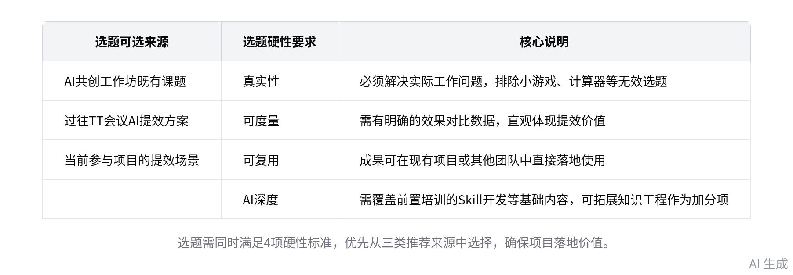
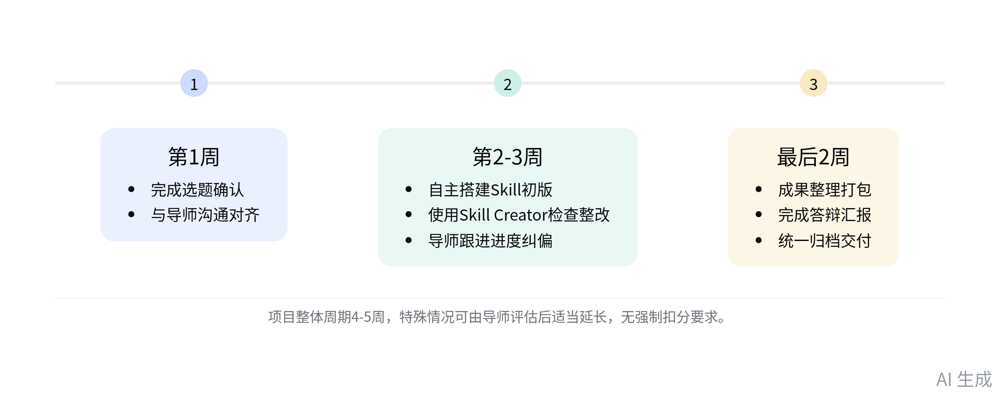
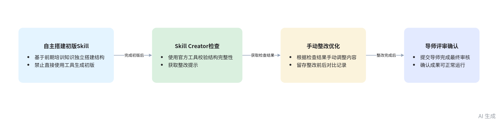
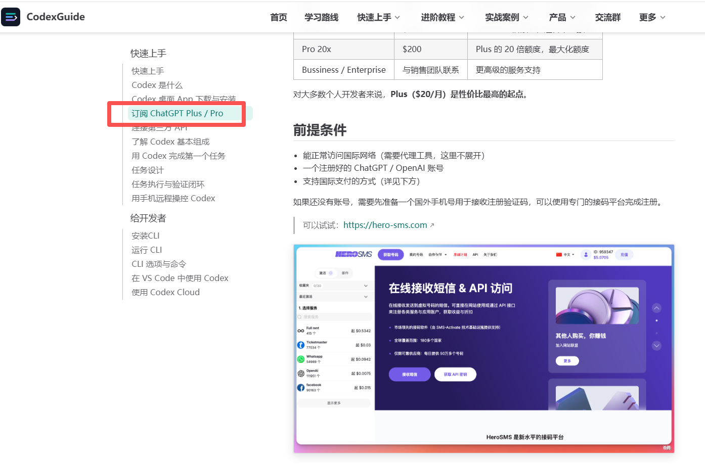

# 智能纪要：汽车BG2026届校招生AI实战演练 kick off 2026年9月16日

> 会议主题：汽车BG2026届校招生AI实战演练 kick off
> 
> 会议时间：2026年9月16日（周三） 18:58 \- 19:28 （GMT\+08）
> 
> 参会人 \(178\)：@杨文娟@艾婧（Vicky Ai）@白琦鑫@白廷俊@白雪婷@班连杰\.\.\.
> 
> @包飞@常乐@车永雷@陈默@陈希来@成昊@成杰@褚成名@崔步术@崔劲文@邓钱英@丁赫@段凯升@樊雨佳@付博@傅雨凡@高海钰@龚一丹@谷昭悦@郭炳瑞@郭歌@郭婧祎@郝华屹@贺享悦@何振@洪世炜@胡锐@华辰凯@黄楠@黄棚@黄睿珂@黄旺来@黄有林@黄钊敏@贾若琳@姜雨蒙@蒋远航@姜云腾@兰德香@兰天@黎道东@李洪霖@李佳彤@李荣华@李诗稳@李涛涛@李新格@李兴@李萱嘉@李滟泽@李毅辰@李勇成@梁思成@林婉冰@刘峰@刘虹余@刘帅@刘万宇@刘欣桐@刘云锋@刘正臣@刘志浩@娄洪@陆漫漫@卢玉德@陆子涵@吕博学@吕嘉宁@吕娅瑾@马腾@马钰@毛思宇@孟政言@孟子睿@彭君@齐悦妍@秦丰睿@秦佳豪@秦志强@冉浪杰@沈岩@史海波@宋萌雨@孙丹@孙琦@孙千棋@邰帅@唐竞远@唐鑫阳@童麟雯@王恩贺@王浩南@王俊鹏@王康@王来卿@王鹏@王冉@王天宇@汪尧@王有成
> 
> @王雨盟@王云龙@王展@王兆宇@王梓蓬@魏思蓉@魏旭@位旭彤@吴疏桐@吴鑫曈@夏晓@谢明雪@谢鹏@邢逸凡@邢怡静@熊佳航@熊维维@徐博强@许超@许欢@许敏君@许明峰@徐明慧@徐杉@徐思崇@杨碧@杨博天@杨甜@姚福星@尤畅@于春柳@于佳莹@俞乾@于智远@袁伟伟@岳蓬星@张爱霞@张博@张方辉@张锋@张浩@张浩浩@张露飞@章任煜@张树新@张小龙@张馨月@张燕蕾@张潆文@张宇@张钰杰@张郅昱@张子成@张子雄@赵洪@赵连生@赵鸣远@赵莎@赵雅非@赵有维@赵云@郑岱@郑丽泽@郑炜峰@郑希雅@郑亚卓@周俊杰@周雯雯@周岩@朱保朋@左林翼@左奕凡
> 
> 

> 智能会议纪要由 AI 生成，可能不准确，请谨慎甄别后使用
> 
> 

# 总结

本次会议面向汽车 BG 26 届校招生及对应导师、BP 伙伴，宣贯部门内 AI 实战项目的统一框架与落地要求，内容如下：

- **项目背景与整体定位**

    - **发起背景**：结合今年 AI 行业背景及前期调研反馈，校招生普遍希望增加 AI 实操、减少线上刷课，故在入职两个月节点设置该项目。

    - **项目核心定位**

        - 项目核心目标：推动校招生完成 AI 知识从学习到落地解决问题的阶段性转化，核心为 AI 技能开发实战演练。

        - 拓展学习渠道：前期培训内容为必修基础，可参考涛哥公开的 AI 相关知识内容作为拓展学习资料。

    - **参与方职责划分**：BG 主导关键节点跟进，校招生、导师、直属上级、部门 HRBP 共同推进，避免各部门执行标准不统一。

- **项目核心执行规则**

    - **选题相关要求**

        - 选题可选来源：可从 AI 共创工作坊既有课题、过往 TT 会议 AI 提效方案、当前参与项目的提效场景三类方向选择。

        - 选题硬性标准：需满足真实性（解决实际工作问题，排除小游戏等无效选题）、可度量、可复用、具备基础 AI 深度四项要求，可拓展知识工程内容作为加分项。

    - **时间周期安排**

        - 整体周期设置：项目整体周期为 4\-5 周，第 1 周为选题阶段，第 2\-3 周为开发实现阶段，最后 2 周为总结答辩阶段。

        - 周期调整规则：若因工作负荷、选题难度需延长周期，由导师评估确认，无强制扣分要求。

    - **交付物规范要求**

        - 开发流程要求：需自主搭建技能初版结构，使用 Anthropic 官方 Skill Creator 工具检查整改，禁止直接用工具生成初版。

        - 交付物结构要求：需按统一结构化要求打包提交，包含 README、选题申报表、过程记录、源码、测试用例及结果等内容。

        - 交付物校验标准：最终提交成果需可正常运行，README 清晰说明内容结构，配套完整测试用例与效果对比数据。

    - **考核与答辩规则**

        - 中期跟进要求：导师需在开发阶段跟进进度，及时纠偏方向，若遇开发受阻可协助调整选题或提供支持。

        - 考核答辩标准：由对应导师及部门负责人参照统一评分标准打分，答辩汇报 15\-20 分钟，配套 10 分钟 QA 环节。

        - 成果后续处理：所有交付成果将统一归档，优质成果可由部门识别后跟进持续迭代优化。

- **AI 工具采购相关规则**

    - **预算额度标准**：项目周期内为每位参与者提供最高 150 元的 AI 工具采购预算，超出部分需由参与者自行承担。

    - **报销流程要求**：需通过官方渠道采购，凭支付截图及抬头为武汉慧行的发票向杨文娟申请，开错主体需自行处理报销，禁止第三方代买。

    - **兜底工具方案**：若预算内无合适工具，可使用内部 Toder 工具作为兜底，相关使用疑问可咨询杨文娟。

- **参与范围与落地说明**

    - **参与范围要求**：研发岗（含开发、测试、AI 算法、AI agent 类）要求全员参与，职能类岗位鼓励自愿参与。

    - **落地调整规则**：本次发布的为 BG 统一框架，各部门及参与者可结合实际情况调整，只要整体方向不跑偏即可。

    - **近期工作安排**

        - 本周核心任务：参与者需在本周内与导师、直属上级沟通确认选题，完成 AI 工具账号的采购工作。

        - 节点跟进安排：杨文娟将在下周三对接各部门 BP 收集选题申报表，各节点材料收集将由对应负责人同步通知，无需提前纠结提交路径。

    - **疑问反馈渠道**：会议未覆盖的疑问可会后私下联系杨文娟或褚成名咨询，会议录屏及总结将同步发至会议群。

# 待办

* [ ] 选题沟通确认：与导师及直属上级沟通确认 AI 工具相关选题，同步完成 AI 账号购买事宜（来自杨文娟）

* [ ] 选题汇总收集：于下周三对接对应部门的 BP 伙伴，收集参与相关活动人员的选题汇总信息 @杨文娟

# 会议中的金句时刻

# 相关链接

- 妙记：[汽车BG2026届校招生AI实战演练 kick off](https://thundersoft.feishu.cn/minutes/obcn23dk34o54l391zipiqjh?from=ai_minutes)

- 文字记录

    - [汽车BG2026届校招生AI实战演练 kick off 2026年9月16日](https://thundersoft.feishu.cn/docx/PfizdrH8FoFQ13xPJdIcLZbHnvd)

